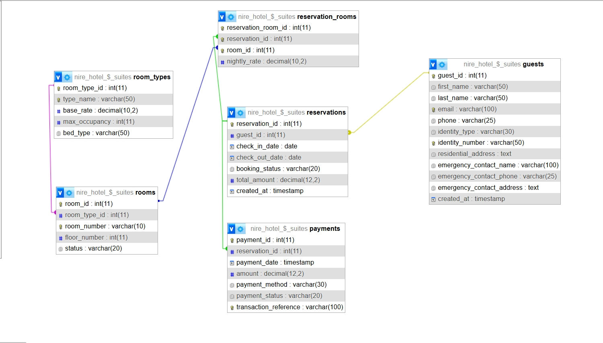
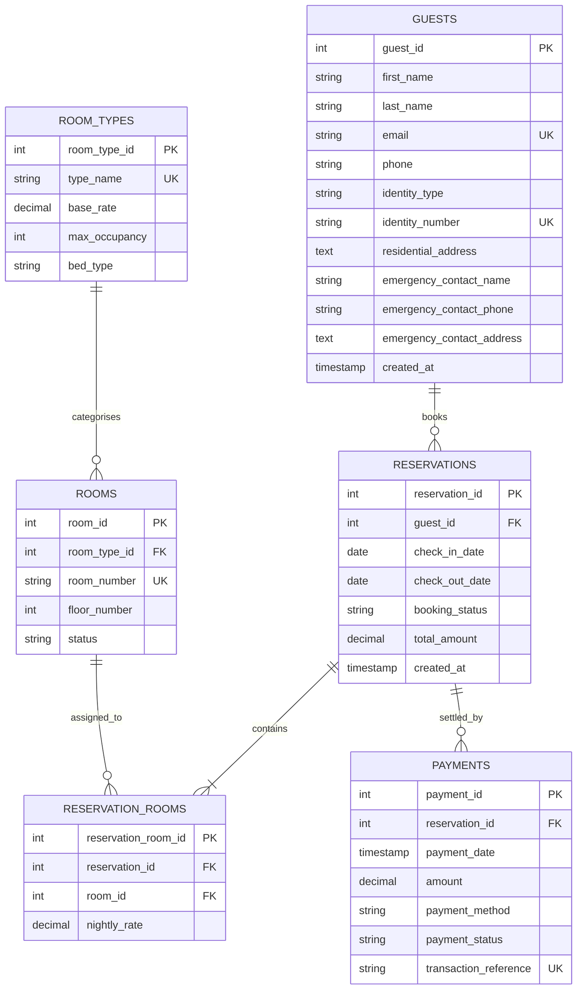

# NIRE Hotel and Suites - Reservation System

A relational database schema and architecture for **NIRE Hotel and Suites**, located in Abuja, Federal Capital Territory (FCT), Nigeria. This repository contains the complete database design, Data Definition Language (DDL) implementation, and Entity-Relationship (ER) diagrams designed for robust, scalable hotel reservation management.

---

## 📋 Table of Contents
- [Overview](#overview)
- [Key Features](#key-features)
- [Entity-Relationship Diagram (ERD)](#entity-relationship-diagram-erd)
  - [Visual Diagram](#visual-diagram)
  - [Interactive Mermaid ERD](#interactive-mermaid-erd)
- [Database Architecture & Data Dictionary](#database-architecture--data-dictionary)
  - [1. Room Types (`room_types`)](#1-room-types-room_types)
  - [2. Physical Rooms (`rooms`)](#2-physical-rooms-rooms)
  - [3. Guests (`guests`)](#3-guests-guests)
  - [4. Reservations (`reservations`)](#4-reservations-reservations)
  - [5. Reservation Rooms Link (`reservation_rooms`)](#5-reservation-rooms-link-reservation_rooms)
  - [6. Payments (`payments`)](#6-payments-payments)
- [Business Rules & Integrity Constraints](#business-rules--integrity-constraints)
- [Installation & Deployment](#installation--deployment)
- [Repository Structure](#repository-structure)

---

## 🏨 Overview

The NIRE Hotel and Suites Reservation System provides a normalized relational database design (MariaDB / MySQL compatible, InnoDB engine) to model core hospitality workflows:
- Room categorization, pricing tiers, and room status tracking.
- Guest identity registration and emergency contact tracking aligned with Nigerian regulatory identification standards.
- Reservation lifecycle management supporting single-room and multi-room bookings.
- Secure payment auditing with support for multiple local payment gateways and transaction references.

---

## ✨ Key Features

- **Multi-Room Reservation Support**: Decoupled `reservations` and `rooms` using the `reservation_rooms` junction entity, enabling guests to book multiple rooms within a single reservation reference.
- **Regulatory Identity & KYC Compliance**: Built-in verification fields for valid Nigerian identification types (`NIN`, `INTERNATIONAL_PASSPORT`, `DRIVERS_LICENSE`, `VOTERS_CARD`) with emergency contact details.
- **Room Lifecycle Tracking**: Dynamic room statuses (`AVAILABLE`, `OCCUPIED`, `RESERVED`, `MAINTENANCE`) to prevent double-booking and coordinate housekeeping/maintenance.
- **Financial Audit Trail**: Tracks transaction references, payment status (`SUCCESSFUL`, `PENDING`, `FAILED`, `REFUNDED`), and payment channels (`POS`, `BANK_TRANSFER`, `DEBIT_CARD`, `CASH`).
- **Referential Integrity**: Implements cascading deletions for dependent transaction/booking records, while restricting deletion of foundational entities (such as room types and guest records with active reservations).

---

## 📊 Entity-Relationship Diagram (ERD)

### Visual Diagram


### Interactive Mermaid ERD
The schema relationships and cardinalities are modeled below:



---

## 🗄️ Database Architecture & Data Dictionary

### 1. Room Types (`room_types`)
Stores distinct room classes, tariffs, and baseline occupancy capacities.

| Column | Type | Constraints | Description |
|---|---|---|---|
| `room_type_id` | `INT` | `PK`, `AUTO_INCREMENT` | Unique identifier for the room type |
| `type_name` | `VARCHAR(50)` | `NOT NULL`, `UNIQUE` | e.g., Standard, Deluxe, Executive Suite |
| `base_rate` | `DECIMAL(10, 2)` | `NOT NULL`, `CHECK (base_rate > 0)` | Base nightly tariff in NGN |
| `max_occupancy` | `INT` | `NOT NULL`, `CHECK (max_occupancy > 0)` | Maximum guests allowed |
| `bed_type` | `VARCHAR(50)` | `NOT NULL` | e.g., King, Queen, Twin Double |

### 2. Physical Rooms (`rooms`)
Represents physical hotel rooms and operational availability.

| Column | Type | Constraints | Description |
|---|---|---|---|
| `room_id` | `INT` | `PK`, `AUTO_INCREMENT` | Unique identifier for physical room |
| `room_type_id` | `INT` | `NOT NULL`, `FK -> room_types(room_type_id)` | Room category (`ON DELETE RESTRICT`) |
| `room_number` | `VARCHAR(10)` | `NOT NULL`, `UNIQUE` | Distinct room number (e.g., "101", "204B") |
| `floor_number` | `INT` | `NOT NULL` | Floor location |
| `status` | `VARCHAR(20)` | `DEFAULT 'AVAILABLE'`, `CHECK (status IN ('AVAILABLE', 'OCCUPIED', 'RESERVED', 'MAINTENANCE'))` | Current operational room state |

### 3. Guests (`guests`)
Profiles registered guests and KYC information.

| Column | Type | Constraints | Description |
|---|---|---|---|
| `guest_id` | `INT` | `PK`, `AUTO_INCREMENT` | Unique guest ID |
| `first_name` | `VARCHAR(50)` | `NOT NULL` | Guest first name |
| `last_name` | `VARCHAR(50)` | `NOT NULL` | Guest surname |
| `email` | `VARCHAR(100)` | `NOT NULL`, `UNIQUE` | Primary email address |
| `phone` | `VARCHAR(25)` | `NOT NULL` | Contact telephone number |
| `identity_type` | `VARCHAR(30)` | `NOT NULL`, `CHECK (identity_type IN ('NIN', 'INTERNATIONAL_PASSPORT', 'DRIVERS_LICENSE', 'VOTERS_CARD'))` | Verification ID document type |
| `identity_number` | `VARCHAR(50)` | `NOT NULL`, `UNIQUE` | Unique ID / document serial |
| `residential_address` | `TEXT` | `NOT NULL` | Contact residential address |
| `emergency_contact_name` | `VARCHAR(100)` | `NOT NULL` | Next of kin / emergency contact |
| `emergency_contact_phone` | `VARCHAR(25)` | `NOT NULL` | Emergency contact phone |
| `emergency_contact_address`| `TEXT` | `NOT NULL` | Emergency contact residential address |
| `created_at` | `TIMESTAMP` | `DEFAULT CURRENT_TIMESTAMP` | Account creation timestamp |

### 4. Reservations (`reservations`)
Maintains reservation master records and stay timelines.

| Column | Type | Constraints | Description |
|---|---|---|---|
| `reservation_id` | `INT` | `PK`, `AUTO_INCREMENT` | Unique reservation code |
| `guest_id` | `INT` | `NOT NULL`, `FK -> guests(guest_id)` | Guest booking the reservation (`ON DELETE RESTRICT`) |
| `check_in_date` | `DATE` | `NOT NULL` | Expected check-in date |
| `check_out_date` | `DATE` | `NOT NULL` | Expected check-out date (`check_out_date > check_in_date`) |
| `booking_status` | `VARCHAR(20)` | `DEFAULT 'CONFIRMED'`, `CHECK (booking_status IN ('CONFIRMED', 'CANCELLED', 'COMPLETED', 'NO_SHOW'))` | Booking state |
| `total_amount` | `DECIMAL(12, 2)` | `DEFAULT 0.00`, `CHECK (total_amount >= 0)` | Total booking charge |
| `created_at` | `TIMESTAMP` | `DEFAULT CURRENT_TIMESTAMP` | Booking timestamp |

### 5. Reservation Rooms Link (`reservation_rooms`)
Junction table linking reservations to individual allocated rooms.

| Column | Type | Constraints | Description |
|---|---|---|---|
| `reservation_room_id` | `INT` | `PK`, `AUTO_INCREMENT` | Record identifier |
| `reservation_id` | `INT` | `NOT NULL`, `FK -> reservations(reservation_id)` | Parent reservation (`ON DELETE CASCADE`) |
| `room_id` | `INT` | `NOT NULL`, `FK -> rooms(room_id)` | Allocated room (`ON DELETE RESTRICT`) |
| `nightly_rate` | `DECIMAL(10, 2)` | `NOT NULL`, `CHECK (nightly_rate >= 0)` | Rate locked in at reservation time |

*Note: Enforces composite uniqueness on `(reservation_id, room_id)` to prevent assigning the same room twice in one reservation.*

### 6. Payments (`payments`)
Financial ledger recording settled, pending, and refunded transactions.

| Column | Type | Constraints | Description |
|---|---|---|---|
| `payment_id` | `INT` | `PK`, `AUTO_INCREMENT` | Payment receipt record ID |
| `reservation_id` | `INT` | `NOT NULL`, `FK -> reservations(reservation_id)` | Associated reservation (`ON DELETE CASCADE`) |
| `payment_date` | `TIMESTAMP` | `DEFAULT CURRENT_TIMESTAMP` | Transaction execution date |
| `amount` | `DECIMAL(12, 2)` | `NOT NULL`, `CHECK (amount > 0)` | Amount processed |
| `payment_method` | `VARCHAR(30)` | `NOT NULL`, `CHECK (payment_method IN ('DEBIT_CARD', 'BANK_TRANSFER', 'CASH', 'POS'))` | Payment medium |
| `payment_status` | `VARCHAR(20)` | `DEFAULT 'SUCCESSFUL'`, `CHECK (payment_status IN ('SUCCESSFUL', 'PENDING', 'FAILED', 'REFUNDED'))` | Settlement status |
| `transaction_reference` | `VARCHAR(100)` | `NOT NULL`, `UNIQUE` | Unique payment gateway transaction reference |

---

## 🛡️ Business Rules & Integrity Constraints

1. **Chronological Validity**: Check-out dates must strictly succeed check-in dates via `CONSTRAINT chk_reservation_dates CHECK (check_out_date > check_in_date)`.
2. **Duplicate Prevention**:
   - `email` and `identity_number` are distinct per guest.
   - `room_number` is distinct across all rooms.
   - `transaction_reference` ensures no double-processing of payment receipts.
3. **Data Safety & Cascade Policies**:
   - Deleting a room type is blocked if physical rooms reference it (`ON DELETE RESTRICT`).
   - Deleting a guest is blocked if active reservations exist (`ON DELETE RESTRICT`).
   - Deleting a reservation automatically cascades cleanup to associated `reservation_rooms` and `payments` records (`ON DELETE CASCADE`).

---

## 🚀 Installation & Deployment

### Prerequisites
- MySQL 8.0+ or MariaDB 10.5+
- MySQL Workbench, DBeaver, phpMyAdmin, or MySQL CLI

### Running the Schema Script
1. Clone the repository:
   ```bash
   git clone https://github.com/iam-ayokunumi/NIRE-Hotel-Suites-Reservation-System.git
   cd NIRE-Hotel-Suites-Reservation-System
   ```

2. Create a new database in MySQL/MariaDB:
   ```sql
   CREATE DATABASE nire_hotel_db CHARACTER SET utf8mb4 COLLATE utf8mb4_unicode_ci;
   USE nire_hotel_db;
   ```

3. Import the SQL schema file:
   ```bash
   mysql -u <username> -p nire_hotel_db < Database.sql
   ```

4. Verify tables:
   ```sql
   SHOW TABLES;
   ```

---

## 📁 Repository Structure

```text
NIRE-Hotel-Suites-Reservation-System/
├── Database.sql             # Complete SQL DDL schema definitions
├── database-design.jpeg     # Visual Entity-Relationship Diagram (ERD)
├── Mermaid Diagram.txt      # Mermaid text specification for ER modeling
└── README.md                # System documentation, data dictionary, and guide
```

---

## 📄 License
This project is developed for educational and operational deployment purposes for **NIRE Hotel and Suites - Abuja, FCT**.
