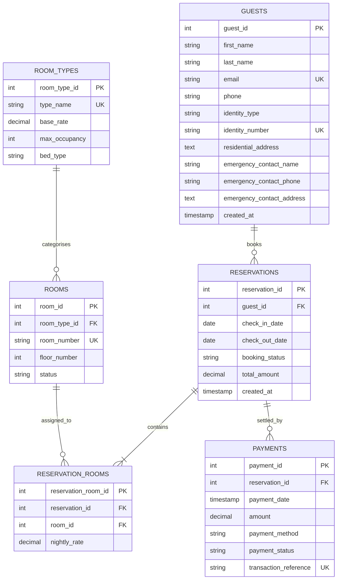

# NIRE Hotel and Suites — Advanced Database Systems Portfolio

**Course:** MIT 8103 - Advanced Database Systems  
**Institution:** MIVA Open University, School of Post Graduate Studies  
**Degree Program:** Master of Information Technology (MIT)  
**Session:** 2026/2027 Academic Session — First Semester Continuous Assessment  
**Student Name:** Samuel Orimolade  
**GitHub Repository:** [iam-ayokunumi/NIRE-Hotel-Suites-Reservation-System](https://github.com/iam-ayokunumi/NIRE-Hotel-Suites-Reservation-System)  

---

## 📋 Table of Contents
- [Executive Overview](#-executive-overview)
- [Semester Portfolio Roadmap](#-semester-portfolio-roadmap)
- [Repository Structure](#-repository-structure)
- [Entity-Relationship Architecture (ERD)](#-entity-relationship-architecture-erd)
- [Portfolio 1: Database Design & Modelling Deliverables](#-portfolio-1-database-design--modelling-deliverables)
- [Installation & Verification Guide](#-installation--verification-guide)
- [Individual Technical Reflection](#-individual-technical-reflection)
- [Academic Integrity & AI Use Declaration](#-academic-integrity--ai-use-declaration)

---

## 🏨 Executive Overview

**NIRE Hotel and Suites** is an upscale hospitality establishment operating in Abuja, Federal Capital Territory (FCT), Nigeria. This repository represents the progressive practical database portfolio developed throughout the semester for **MIT 8103: Advanced Database Systems**.

### System Scope & Core Operations:
* **Room Inventory Categorization:** Distinct room tiers (`Standard Room`, `Deluxe Room`, `Executive Suite`, `Presidential Suite`, `Family Suite`) spanning multiple physical floors with live status management (`AVAILABLE`, `OCCUPIED`, `RESERVED`, `MAINTENANCE`).
* **Guest Profiling & Statutory KYC:** Registration strictly aligned with Nigerian identity standards (`NIN`, `INTERNATIONAL_PASSPORT`, `DRIVERS_LICENSE`, `VOTERS_CARD`) with verified emergency contact records.
* **Reservation Lifecycle:** Single and multi-room bookings via a normalized junction entity (`reservation_rooms`) with arrival and departure scheduling.
* **Financial Ledger Auditing:** Settlements captured across Nigerian payment channels (`POS`, `BANK_TRANSFER`, `DEBIT_CARD`, `CASH`) with gateway transaction tracking and refund handling.

---

## 📊 Semester Portfolio Roadmap

| Portfolio Component | Activity Focus | Status | Deliverables Location |
| :--- | :--- | :---: | :--- |
| **Portfolio 1** | Database Design & Modelling | **Completed** | [`portfolio-1-database-design/`](portfolio-1-database-design/) |
| **Portfolio 2** | Query Processing & Optimisation | Scheduled | *Upcoming Semester Activity* |
| **Portfolio 3** | Transactions & Concurrency | Scheduled | *Upcoming Semester Activity* |
| **Portfolio 4** | NoSQL & Advanced Data Models | Scheduled | *Upcoming Semester Activity* |
| **Portfolio 5** | Distributed & Cloud Databases | Scheduled | *Upcoming Semester Activity* |

---

## 📁 Repository Structure

```text
advanced-database-portfolio/
├── portfolio-1-database-design/
│   ├── schema.sql                         # Complete relational DDL with constraints
│   ├── seed_data.sql                      # Realistic sample dataset (20 rooms, 12 guests, 15 bookings)
│   ├── normalization_analysis.md          # Step-by-step mathematical proof (UNF to BCNF)
│   ├── database-design.jpeg               # Visual Entity-Relationship Diagram (ERD)
│   ├── mermaid-erd.mmd                    # Mermaid schema code definition
│   └── README.md                          # Data dictionary and implementation guide
└── README.md                              # Portfolio overview and activity roadmap
```

---

## 📊 Entity-Relationship Architecture (ERD)

### Visual Diagram


### Interactive Mermaid ERD


---

## 🚀 Portfolio 1: Database Design & Modelling Deliverables

Portfolio 1 establishes the relational foundation of the reservation architecture:
1. **Relational Schema Definition ([`schema.sql`](portfolio-1-database-design/schema.sql)):** Fully normalized MySQL 8.0+ / MariaDB 10.4+ schema with InnoDB storage engine, primary/foreign keys, `CHECK` constraints, and cascading integrity policies.
2. **Seed Dataset ([`seed_data.sql`](portfolio-1-database-design/seed_data.sql)):** Comprehensive sample data populating 5 room types, 20 physical rooms across 4 floors, 12 guests with authentic Nigerian KYC credentials, 15 reservations, multi-room allocations, and payment receipts.
3. **Relational Normalization Proof ([`normalization_analysis.md`](portfolio-1-database-design/normalization_analysis.md)):** Mathematical functional dependency analysis demonstrating formal progression from Unnormalized Form (UNF) through 1NF, 2NF, 3NF, to **Boyce-Codd Normal Form (BCNF)**.
4. **Data Dictionary & Documentation ([`portfolio-1-database-design/README.md`](portfolio-1-database-design/README.md)):** Detailed entity definitions, domain rules, and verification outputs.

---

## ⚡ Installation & Verification Guide

### Prerequisites
* MySQL 8.0+ or MariaDB 10.4+ (InnoDB engine)
* Client tool (MySQL CLI, MySQL Workbench, DBeaver, or phpMyAdmin)

### Execution Commands (PowerShell)
```powershell
# 1. Execute DDL Schema
Get-Content "portfolio-1-database-design\schema.sql" | & "C:\xampp\mysql\bin\mysql.exe" -u root

# 2. Populate Seed Dataset
Get-Content "portfolio-1-database-design\seed_data.sql" | & "C:\xampp\mysql\bin\mysql.exe" -u root

# 3. Verify Table Row Counts
& "C:\xampp\mysql\bin\mysql.exe" -u root -e "USE nire_hotel_db; SELECT 'room_types' AS tbl, COUNT(*) AS count FROM room_types UNION ALL SELECT 'rooms', COUNT(*) FROM rooms UNION ALL SELECT 'guests', COUNT(*) FROM guests UNION ALL SELECT 'reservations', COUNT(*) FROM reservations UNION ALL SELECT 'reservation_rooms', COUNT(*) FROM reservation_rooms UNION ALL SELECT 'payments', COUNT(*) FROM payments;"
```

**Verification Output:**
```text
+-------------------+-------+
| tbl               | count |
+-------------------+-------+
| room_types        |     5 |
| rooms             |    20 |
| guests            |    12 |
| reservations      |    15 |
| reservation_rooms |    15 |
| payments          |    15 |
+-------------------+-------+
```

---

## 💡 Individual Technical Reflection

* **Design Rationale:** Isolating historical nightly rates within the junction relation `reservation_rooms` (`nightly_rate DECIMAL(10,2)`) guarantees financial immutability. Base tariffs in `room_types` can fluctuate seasonally or increase due to inflation without retroactively altering historical reservation totals.
* **Integrity & Cascade Policies:** Restricting deletions on core entities (`ON DELETE RESTRICT` for `room_types`, `rooms`, and `guests`) prevents accidental operational disruption, while cascading cleanup (`ON DELETE CASCADE` for `reservation_rooms` and `payments`) ensures that purged bookings leave zero orphan records.
* **Regulatory Compliance:** Integrating Nigerian identity types (`NIN`, `INTERNATIONAL_PASSPORT`, `DRIVERS_LICENSE`, `VOTERS_CARD`) directly into domain check constraints ensures the database enforces KYC compliance at the storage engine level rather than relying solely on client-side validation.

---

## 🛡️ Academic Integrity & AI Use Declaration

In compliance with the University’s Academic Integrity standards (Section 11 of the CA Brief):
* **AI Tool Used:** Antigravity IDE (Powered by Gemini).
* **Application Scope:** Scaffolding initial schema templates, structuring DDL constraints, formatting Markdown documentation, and formalizing normalization functional dependency notation.
* **Verification & Testing Protocol:** All SQL DDL scripts, constraints, and seed data records were manually reviewed, executed, and tested on a live MariaDB 10.4.32 database instance running via XAMPP. Every table creation and data insertion was verified through direct command-line execution and integrity testing.
