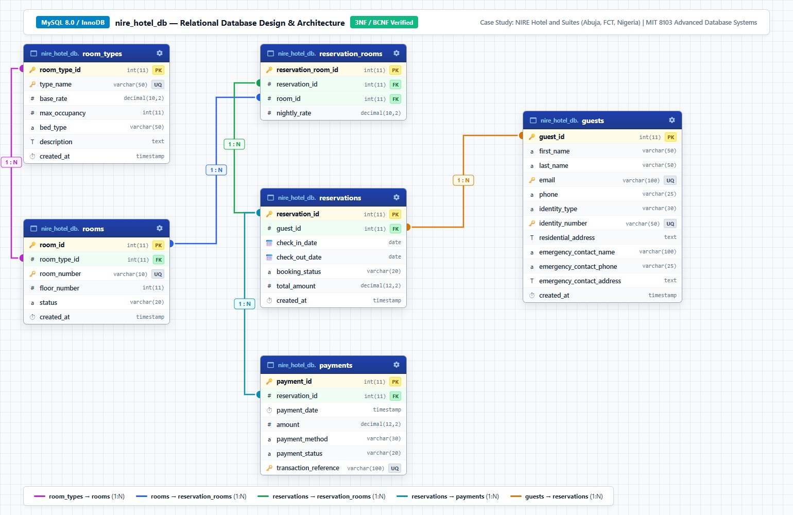
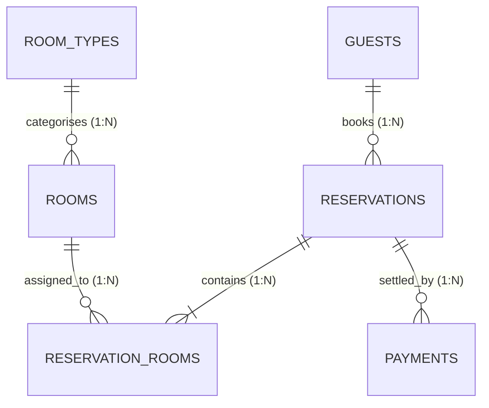

# Portfolio 1: Database Design and Modelling

**Course:** MIT 8103 - Advanced Database Systems  
**Institution:** MIVA Open University  
**Case Study:** NIRE Hotel and Suites - Reservation System (Abuja, FCT, Nigeria)

---

## 1. Case Study & Business Scenario

**NIRE Hotel and Suites** is an upscale hospitality establishment situated in the Federal Capital Territory (Abuja, Nigeria). The organization caters to domestic travelers, business executives, international diplomats, and corporate delegations. 

### Operational Workflow:
1. **Room Inventory Management:** Rooms are categorized into tiers (`Standard Room`, `Deluxe Room`, `Executive Suite`, `Presidential Suite`, `Family Suite`), located across multiple floors, and tracked through live operational statuses (`AVAILABLE`, `OCCUPIED`, `RESERVED`, `MAINTENANCE`).
2. **Guest Identity & KYC Compliance:** Every guest profile registers verified identity credentials strictly adhering to Nigerian statutory identity standards (`NIN`, `INTERNATIONAL_PASSPORT`, `DRIVERS_LICENSE`, `VOTERS_CARD`) alongside verified emergency contact records.
3. **Reservation Lifecycle:** Guests book accommodations across specified check-in and check-out periods. A reservation can encapsulate single or multi-room bookings via a normalized junction entity (`reservation_rooms`).
4. **Financial Transactions:** Settlements are tracked via individual transaction receipts, capturing multiple local payment methods (`POS`, `BANK_TRANSFER`, `DEBIT_CARD`, `CASH`) with unique gateway transaction references and statuses (`SUCCESSFUL`, `PENDING`, `REFUNDED`).

---

## 2. Entity-Relationship Diagram (ERD)

### Visual Diagram


### Mermaid Cardinality Diagram


---

## 3. Relational Schema & Data Dictionary

### Table 1: `room_types`
| Column | Type | Nullable | Key | Constraints | Description |
|---|---|---|---|---|---|
| `room_type_id` | `INT` | NO | PK | `AUTO_INCREMENT` | Surrogate primary identifier |
| `type_name` | `VARCHAR(50)` | NO | UK | `UNIQUE` | Distinct room tier name |
| `base_rate` | `DECIMAL(10, 2)` | NO | | `CHECK (base_rate > 0)` | Standard nightly rate in NGN |
| `max_occupancy` | `INT` | NO | | `CHECK (max_occupancy > 0)` | Maximum guest capacity |
| `bed_type` | `VARCHAR(50)` | NO | | | Bed configuration description |
| `description` | `TEXT` | YES | | | Tier overview and amenities |
| `created_at` | `TIMESTAMP` | NO | | `DEFAULT CURRENT_TIMESTAMP`| Audit record creation timestamp |

### Table 2: `rooms`
| Column | Type | Nullable | Key | Constraints | Description |
|---|---|---|---|---|---|
| `room_id` | `INT` | NO | PK | `AUTO_INCREMENT` | Unique physical room ID |
| `room_type_id` | `INT` | NO | FK | `REFERENCES room_types` | Associated classification tier |
| `room_number` | `VARCHAR(10)` | NO | UK | `UNIQUE` | Physical room door identifier |
| `floor_number` | `INT` | NO | | `CHECK (floor_number >= 0)`| Physical floor level |
| `status` | `VARCHAR(20)` | NO | | `CHECK (status IN ...)` | `AVAILABLE`, `OCCUPIED`, `RESERVED`, `MAINTENANCE` |
| `created_at` | `TIMESTAMP` | NO | | `DEFAULT CURRENT_TIMESTAMP`| Audit record creation timestamp |

### Table 3: `guests`
| Column | Type | Nullable | Key | Constraints | Description |
|---|---|---|---|---|---|
| `guest_id` | `INT` | NO | PK | `AUTO_INCREMENT` | Unique guest record identifier |
| `first_name` | `VARCHAR(50)` | NO | | | Guest first name |
| `last_name` | `VARCHAR(50)` | NO | | | Guest surname |
| `email` | `VARCHAR(100)` | NO | UK | `UNIQUE` | Primary email contact |
| `phone` | `VARCHAR(25)` | NO | | | Telephone contact number |
| `identity_type` | `VARCHAR(30)` | NO | | `CHECK (identity_type IN ...)`| `NIN`, `INTERNATIONAL_PASSPORT`, `DRIVERS_LICENSE`, `VOTERS_CARD` |
| `identity_number`| `VARCHAR(50)`| NO | UK | `UNIQUE` | Government identity number |
| `residential_address`| `TEXT` | NO | | | Verified residential street address |
| `emergency_contact_name`| `VARCHAR(100)`| NO | | | Next of kin full name |
| `emergency_contact_phone`| `VARCHAR(25)`| NO | | | Emergency telephone number |
| `emergency_contact_address`| `TEXT` | NO | | | Emergency contact residence |
| `created_at` | `TIMESTAMP` | NO | | `DEFAULT CURRENT_TIMESTAMP`| Record registration timestamp |

### Table 4: `reservations`
| Column | Type | Nullable | Key | Constraints | Description |
|---|---|---|---|---|---|
| `reservation_id` | `INT` | NO | PK | `AUTO_INCREMENT` | Master booking code |
| `guest_id` | `INT` | NO | FK | `REFERENCES guests` | Guest placing the booking |
| `check_in_date` | `DATE` | NO | | | Scheduled arrival date |
| `check_out_date`| `DATE` | NO | | `CHECK (check_out_date > check_in_date)` | Scheduled departure date |
| `booking_status`| `VARCHAR(20)` | NO | | `CHECK (booking_status IN ...)` | `CONFIRMED`, `CANCELLED`, `COMPLETED`, `NO_SHOW` |
| `total_amount` | `DECIMAL(12, 2)`| NO | | `CHECK (total_amount >= 0)` | Calculated aggregate reservation cost |
| `created_at` | `TIMESTAMP` | NO | | `DEFAULT CURRENT_TIMESTAMP`| Booking generation timestamp |

### Table 5: `reservation_rooms`
| Column | Type | Nullable | Key | Constraints | Description |
|---|---|---|---|---|---|
| `reservation_room_id`| `INT` | NO | PK | `AUTO_INCREMENT` | Junction allocation identifier |
| `reservation_id` | `INT` | NO | FK | `REFERENCES reservations (CASCADE)` | Parent booking reference |
| `room_id` | `INT` | NO | FK | `REFERENCES rooms (RESTRICT)` | Allocated physical room |
| `nightly_rate` | `DECIMAL(10, 2)`| NO | | `CHECK (nightly_rate >= 0)` | Historical rate locked at booking time |
| *(Composite)* | | | UK | `UNIQUE(reservation_id, room_id)` | Prevents duplicate room assignment |

### Table 6: `payments`
| Column | Type | Nullable | Key | Constraints | Description |
|---|---|---|---|---|---|
| `payment_id` | `INT` | NO | PK | `AUTO_INCREMENT` | Transaction voucher ID |
| `reservation_id` | `INT` | NO | FK | `REFERENCES reservations (CASCADE)` | Associated reservation reference |
| `payment_date` | `TIMESTAMP` | NO | | `DEFAULT CURRENT_TIMESTAMP` | Transaction execution timestamp |
| `amount` | `DECIMAL(12, 2)`| NO | | `CHECK (amount > 0)` | Amount processed in NGN |
| `payment_method` | `VARCHAR(30)` | NO | | `CHECK (payment_method IN ...)`| `DEBIT_CARD`, `BANK_TRANSFER`, `CASH`, `POS` |
| `payment_status` | `VARCHAR(20)` | NO | | `CHECK (payment_status IN ...)`| `SUCCESSFUL`, `PENDING`, `FAILED`, `REFUNDED` |
| `transaction_reference`| `VARCHAR(100)`| NO | UK | `UNIQUE` | External financial settlement reference |

---

## 4. Normalization Proof Summary

A detailed mathematical and dependency proof is documented in [`Orimolade_Samuel_301923593_normalization_analysis.md`](Orimolade_Samuel_301923593_normalization_analysis.md). In brief:
* **1NF:** Elimination of repeating room and payment arrays into discrete tuples; all attributes are atomic scalar values with designated primary keys.
* **2NF:** Elimination of partial functional dependencies on composite candidate key `{reservation_id, room_id}` by isolating room specifications into the `rooms` relation.
* **3NF:** Elimination of transitive dependencies ($\text{reservation\_id} \to \text{guest\_id} \to \text{guest details}$ and $\text{room\_id} \to \text{room\_type\_id} \to \text{tariffs}$) by decoupling `guests` and `room_types`.
* **BCNF:** Every determinant across the schema is an explicit superkey or candidate key.

---

## 5. Execution and Verification Guide

### Prerequisites
* MySQL 8.0+ or MariaDB 10.4+ (InnoDB engine)

### Commands to Run and Verify
```powershell
# 1. Execute DDL Schema
Get-Content "portfolio-1-database-design\Orimolade_Samuel_301923593_schema.sql" | & "C:\xampp\mysql\bin\mysql.exe" -u root

# 2. Populate Seed Dataset
Get-Content "portfolio-1-database-design\Orimolade_Samuel_301923593_seed_data.sql" | & "C:\xampp\mysql\bin\mysql.exe" -u root

# 3. Verify Table Counts
& "C:\xampp\mysql\bin\mysql.exe" -u root -e "USE nire_hotel_db; SELECT 'room_types' AS tbl, COUNT(*) AS count FROM room_types UNION ALL SELECT 'rooms', COUNT(*) FROM rooms UNION ALL SELECT 'guests', COUNT(*) FROM guests UNION ALL SELECT 'reservations', COUNT(*) FROM reservations UNION ALL SELECT 'reservation_rooms', COUNT(*) FROM reservation_rooms UNION ALL SELECT 'payments', COUNT(*) FROM payments;"
```

**Verification Output:**
```
tbl                 count
room_types          5
rooms               20
guests              12
reservations        15
reservation_rooms   15
payments            15
```
